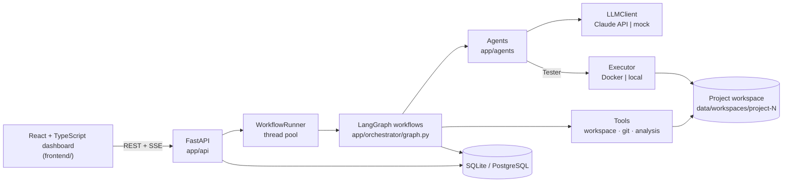
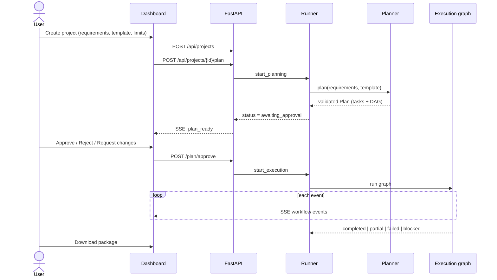
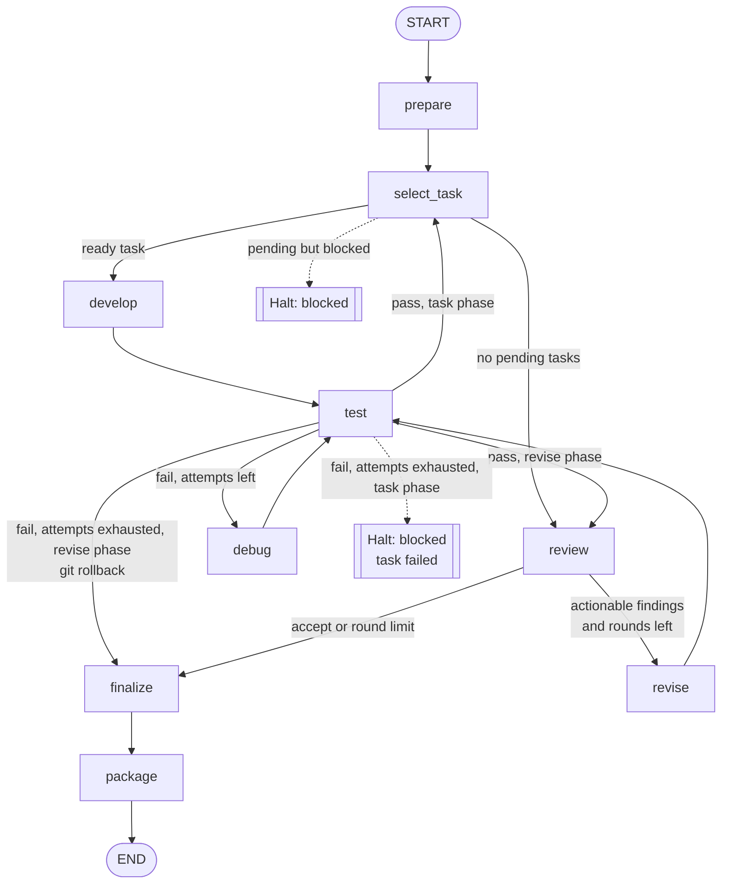
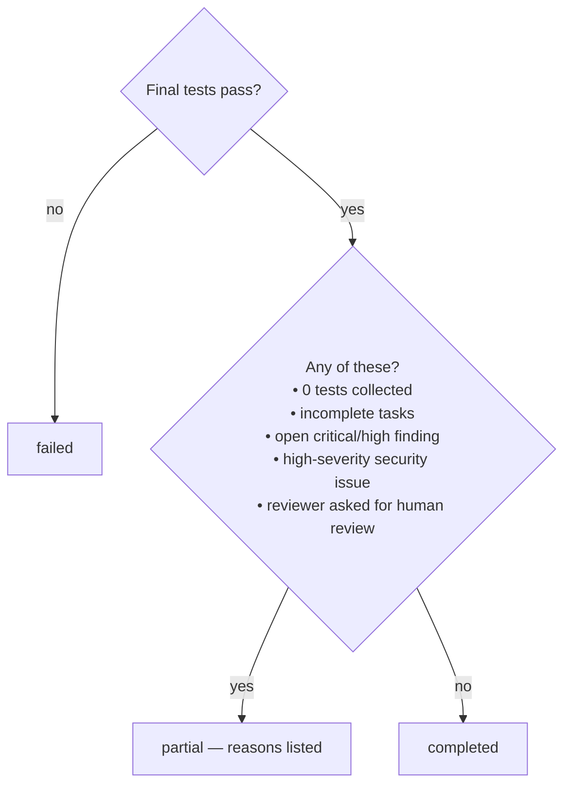
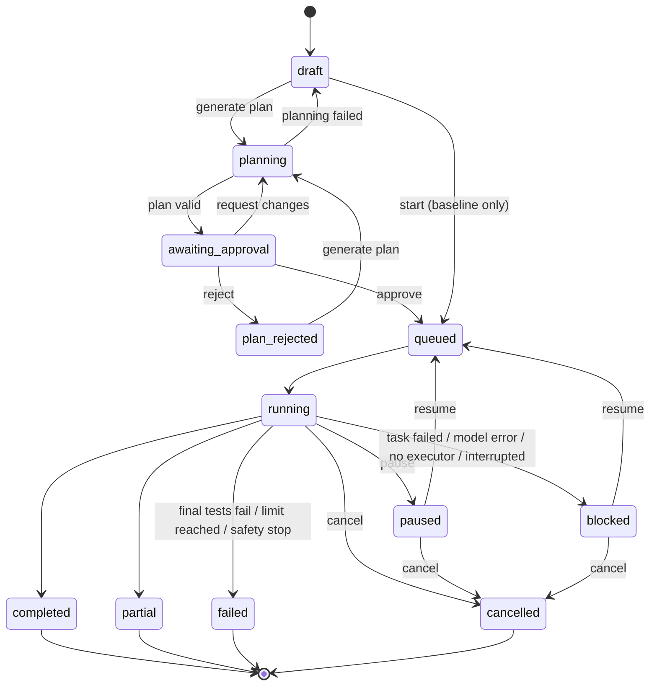
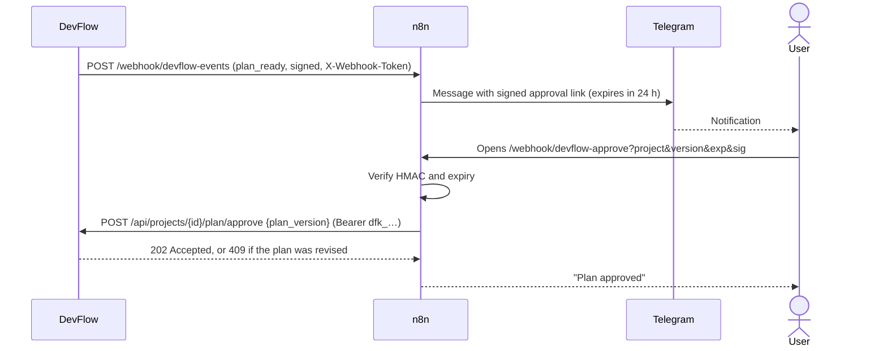

# DevFlow AI — Implementation Status and System Flow

**Version:** 1.0.0 · **Date:** 2026-10-22 · **Covers:** the code in this repository as it currently exists

This document records what is implemented, what has been verified, and how a request flows through the system from requirement to delivered package. For setup instructions see the [README](../README.md).

---

## 1. Status at a glance

| Area | State | Notes |
|---|---|---|
| Backend API (FastAPI) | Implemented, tested | Auth, projects, workflow control, inspection, SSE, delivery |
| Orchestration (LangGraph) | Implemented, tested | Planning graph, execution graph, single-agent baseline graph |
| Planner / Developer / Debugger / Reviewer agents | Implemented, tested with mock provider | Structured outputs validated by Pydantic |
| Tester agent | Implemented, tested | Deterministic: real pytest + JUnit XML, never a model |
| Claude API client | Implemented, **not yet run against the live API** | No API key was available during development |
| Mock LLM provider | Implemented, tested | 4 scripted scenarios; ignores the actual requirements |
| Workspace path guard | Implemented, tested | 20 rejection cases covered |
| Dependency allow-list | Implemented, tested | Applied to `requirements.txt` changes |
| Docker sandbox executor | Implemented, **not yet run** | Docker daemon was not running during development |
| Local executor | Implemented, tested | Not isolated; opt-in only |
| Static analysis + security scan | Implemented, tested | Ruff (parse only) + AST scanner |
| Git history per project | Implemented, tested | Commit per change set; rollback on failed revision |
| Pause / resume / cancel | Implemented, tested | Takes effect at step boundaries |
| Budget / time / retry limits | Implemented | Retry limits tested; cost limit only meaningful with a paid provider |
| Persistence (SQLite / PostgreSQL) | SQLite tested; PostgreSQL configurable, untested | 10 tables per spec §14 |
| Delivery package | Implemented, tested | Zip with source, report, manifest |
| Metrics (FR-18) | Implemented, tested | Per project and aggregated by mode |
| Benchmark harness | Implemented, run with mock | 3 tasks with hidden acceptance tests |
| React dashboard | Implemented, manually verified in browser | All 10 screens from spec §16, plus Integrations |
| Outbound webhooks | Implemented, tested | Signed, filtered, retried, logged; used by n8n |
| API keys | Implemented, tested | Hashed, revocable keys for automation |
| n8n workflows | Written; see §16 for verification | Notifications, link approval, project form |
| Automated tests | 61 backend tests pass; frontend type-checks and builds | No frontend unit tests |

---

## 2. Architecture



| Layer (spec §8) | Location | Responsibility |
|---|---|---|
| Presentation | `frontend/src` | Screens, live updates, human decisions |
| Application / API | `backend/app/api`, `security.py` | Auth, validation, ownership checks, starting workflows |
| Orchestration | `backend/app/orchestrator` | Graphs, routing, limits, status transitions, packaging |
| Agents | `backend/app/agents` | Prompts, structured output schemas, run recording |
| Tools / execution | `backend/app/tools` | Path policy, sandboxed execution, pytest parsing, Ruff, security scan, Git |
| Data | `backend/app/models.py`, `db.py` | ORM models, sessions |
| Model | `backend/app/llm` | Provider-neutral interface, Claude client, mock |
| Templates | `backend/app/templates` | Approved project template and dependency policy |
| Evaluation | `backend/evaluation` | Benchmark tasks, hidden acceptance tests, runner |

### Directory map

```
DEVFLOW/
├── backend/
│   ├── app/
│   │   ├── main.py                 FastAPI app, startup recovery
│   │   ├── config.py               DEVFLOW_* settings
│   │   ├── db.py / models.py       persistence
│   │   ├── security.py             password hashing, tokens, ownership
│   │   ├── metrics.py              FR-18 metrics
│   │   ├── api/                    auth.py, projects.py, system.py, schemas.py
│   │   ├── agents/                 schemas.py, base.py, roles.py, tester.py
│   │   ├── llm/                    base.py, anthropic_client.py, mock_client.py, mock_scenario.py
│   │   ├── orchestrator/           graph.py, context.py, runner.py, recorder.py, delivery.py
│   │   ├── tools/                  workspace.py, executor.py, testing.py, analysis.py, git_tools.py
│   │   └── templates/fastapi_service/
│   ├── evaluation/                 run_benchmark.py, benchmark/
│   └── tests/                      55 tests
├── frontend/src/                   App.tsx, api.ts, pages/, project/, components/
├── sandbox/Dockerfile              execution image
└── docker-compose.yml              sandbox build + optional PostgreSQL
```

---

## 3. End-to-end user flow



Single-agent baseline projects skip planning and approval: `POST /api/projects/{id}/start` runs the baseline graph directly.

---

## 4. Planning flow

Graph: `plan → persist_plan → END` (`PlanningWorkflow` in `graph.py`).

1. **plan** — `PlannerAgent.plan()` sends the template (description, approved dependencies, conventions), project name, requirements, and user constraints. On a revision request it also sends the previous plan and the feedback.
2. The model returns JSON matching the `Plan` schema. Pydantic validation rejects:
   - task ids not shaped like `T1`, `T2`, …
   - duplicate ids, unknown dependencies, self-dependencies
   - dependency cycles (topological sort)
   If validation fails, the Claude client sends the error back once for a corrected answer.
3. **persist_plan** — replaces any previous tasks, stores the plan, increments `plan_version`, orders tasks topologically, sets status `awaiting_approval`. If the planner listed clarification questions, the status reason says so; the user answers them through "Request changes".

**Plan contents:** summary, functional requirements, non-functional requirements, assumptions, constraints, clarifications needed, acceptance criteria, components (with interfaces), tech stack, expected directory structure, tasks (id, title, description, depends_on, expected_outputs, acceptance_criteria).

**Human decisions** (each stored in `approvals` and `workflow_events`):

| Action | Endpoint | Result |
|---|---|---|
| Approve | `POST /plan/approve` | Execution starts |
| Reject | `POST /plan/reject` | Status `plan_rejected`; can re-plan |
| Request changes | `POST /plan/revise` | Planner re-runs with feedback; plan v+1 |

No code is generated or executed before approval.

---

## 5. Execution flow

### 5.1 Graph



Every node is wrapped so it first checks the project's `control` flag: `pause` raises `PauseRequested`, `cancel` raises `CancelRequested`. The runner catches these and sets the status. The recursion limit is 400 steps.

### 5.2 Nodes in detail

**prepare**
- Creates the workspace directory. On first run: copies the template, `git init`, commits `Initialize from template fastapi_service v1.0.0`.
- On resume: tasks in `running`, `failed` or `blocked` go back to `pending` with debug attempts reset. Completed tasks are untouched.

**select_task**
- Loads tasks in topological order, picks the first `pending` task whose dependencies are all `completed`, marks it `running`, increments `attempts`.
- If tasks are pending but none are ready → halt as `blocked`.
- If nothing is pending → route to `review`.

**develop**
- `DeveloperAgent.implement()` receives: template block, approved plan, list of completed tasks, the full workspace snapshot (up to ~400k characters), the task, and any rejection feedback from a previous attempt.
- Returns complete file contents (`create` / `modify` / `delete`), a summary and notes.
- Changes go through `RunContext.apply_changes()` (see §7.1), are committed as `T2: <summary>`, and recorded as `artifacts`.

**test** (Tester agent)
1. Syntax check: every `.py` file is parsed with `ast.parse` on the host (not executed).
2. If the previous run had failing tests: rerun **only those node ids** first (`kind=retest`).
3. If that passes, or there were none: run the **full suite** (`kind=regression` after a fix, `task`, or `revise`).
4. Results come from JUnit XML: passed, failed, errors, skipped, failure messages and tracebacks.
- Pass in task phase → task `completed` with evidence `{test_run_id, summary, commit, debug_attempts}` → `select_task`.
- Pass in revise phase → `review`.
- Fail with attempts left → `debug`.
- Fail with attempts exhausted, task phase → task `failed`, workflow halts `blocked` with the reason. The user can resume (retry) or cancel.
- Fail with attempts exhausted, revise phase → `git reset --hard` to the pre-revision commit → `finalize`.
- "No tests collected" (pytest exit 5) counts as a pass for a task, but `finalize` will not mark the project `completed` with zero tests.

**debug**
- Increments the task's `debug_attempts` (or the revision's counter).
- `DebuggerAgent.diagnose()` receives the task, workspace, the model-facing test report (up to 15 failures + log tail), and previous debug hypotheses so it tries something new.
- Returns root cause, explanation, confidence, minimal file replacements, validation steps. Changes are applied and committed as `T2 fix: <root cause>`.
- Always routes back to `test`.

**review**
- Marks previously open findings `superseded`.
- Runs Ruff (`E9,F,B,S`, ignoring `S101,S311,B008`) and the AST security scan.
- `ReviewerAgent.review()` receives plan, workspace, latest test summary, analysis issues, and previous findings.
- Stores reviewer findings plus high/medium analysis issues as `review_findings` for this round.
- **Blocking findings** = reviewer findings that are actionable with severity critical/high/medium, plus any high-severity analysis issue.
- Blocking findings and `review_round < max_review_rounds` → `revise`; otherwise → `finalize`.

**revise**
- Records the current commit as a rollback checkpoint, increments `review_round`.
- `DeveloperAgent.revise()` receives the blocking findings and must fix them and add tests.
- Routes to `test` in revise phase.

**finalize**
- Runs Ruff + security scan + the full test suite (`kind=final`, with analysis results stored in `checks`).
- Superseded findings become `resolved`.
- Decides the outcome (§5.3).

**package**
- Writes the outcome to the project, then builds `data/packages/project-N-<timestamp>.zip`:
  - `source/…` — every workspace file
  - `DEVFLOW_REPORT.md` — status, setup, tasks, final tests, acceptance criteria, open findings, limitations, assumptions
  - `devflow_manifest.json` — the full report plus config snapshot and commit id

### 5.3 Final outcome rules



### 5.4 Single-agent baseline

Graph: `prepare → single_build → finalize → package`.
One `SingleAgent.build()` call generates the whole project. There is no planning, no task decomposition, no debugging and no review. The same final validation and packaging run, so results are comparable.

---

## 6. State machines

### 6.1 Project status



How the runner maps exceptions to statuses (`runner.py`):

| Exception | Status | Resumable |
|---|---|---|
| `PauseRequested` | paused | yes |
| `CancelRequested` | cancelled | no |
| `Halt(status)` | as given (blocked, or failed for safety stop) | if blocked |
| `BudgetExceeded` | failed | no |
| `ExecutionUnavailable` | blocked | yes, after starting Docker or enabling local execution |
| `LLMError` | blocked | yes |
| any other exception | blocked | yes |

On server start, projects left in `planning` become `draft`; projects left in `queued`/`running` become `blocked` ("Interrupted by a server restart; resume to continue").

### 6.2 Task status

`pending → running → completed`, or `running → failed` when debug attempts are exhausted. On resume, `running`/`failed`/`blocked` tasks return to `pending`.

### 6.3 Review finding status

`open` → `superseded` (when the next review round starts) → `resolved` (at finalize). Findings raised again in the next round appear as new `open` rows.

---

## 7. Agents

| Agent | Class | Model? | Input | Output schema |
|---|---|---|---|---|
| Planner | `PlannerAgent` | yes | requirements, template, constraints, previous plan + feedback | `Plan` |
| Developer | `DeveloperAgent` | yes | plan, task, workspace, completed tasks, feedback / review findings | `DeveloperOutput` |
| Tester | `TesterAgent` | **no** | workspace, optional failing node ids | `TestReport` + `test_runs` row |
| Debugger | `DebuggerAgent` | yes | task, workspace, test report, previous attempts | `DebuggerOutput` |
| Reviewer | `ReviewerAgent` | yes | plan, workspace, test summary, analysis issues, previous findings | `ReviewReport` |
| Baseline | `SingleAgent` | yes | requirements, template, workspace | `DeveloperOutput` |

Every model-backed call goes through `Agent.call()`:
1. `BudgetGuard.check()` — stops if project spend ≥ `max_cost_usd` or active time ≥ `max_workflow_seconds`.
2. Insert an `agent_runs` row and emit `agent_started`.
3. `LLMClient.generate()` with the role's system prompt and output schema.
4. On success: store output, model, tokens, cost, duration; insert a `usage_records` row; emit `agent_finished`. On error: store the error, emit `agent_failed`, re-raise.

### 7.1 Claude client (`llm/anthropic_client.py`)

- `client.beta.messages.stream(...)` → `get_final_message()`
- Model `claude-opus-5-5` (configurable), `output_config = {effort, format: json_schema}`
- Schema from Pydantic via `strict_json_schema()`: refs inlined, all properties required, `additionalProperties: false`
- Prompt caching: `cache_control: {type: ephemeral}`
- Refusal fallback: beta `server-side-fallback-2026-07-01`, `fallbacks="default"`
- Checks `stop_reason` for `refusal` and `max_tokens` before parsing
- One corrective retry on invalid JSON/schema, appending the full assistant turn
- Typed SDK errors mapped to `LLMError` (retryable for rate limit, 5xx, connection)
- Cost estimated from token usage, including cache reads/writes

### 7.2 Mock provider (`llm/mock_client.py`)

Always produces the same 3-task Notes API plan. Scenarios, chosen with the project constraint `mock_scenario`:

| Scenario | Behaviour |
|---|---|
| `default` | T2 ships a delete-endpoint bug → test fails → debugger fixes → reviewer flags missing title validation → revision → completed |
| `clean` | No bug, no revision |
| `unfixable` | Debugger never fixes the bug → retries exhausted → blocked |
| `unsafe` | Developer also writes `../outside_workspace.py` → rejected as a safety violation |

---

## 8. Safety controls

### 8.1 File changes (`RunContext.apply_changes`)

For each change the agent proposes:
1. If the change set exceeds `max_files_per_change` (40), the whole set is rejected.
2. `Workspace.validate(path)` rejects: empty paths, NUL bytes, backslashes, over 200 characters, absolute paths, drive letters, `~`, `..`, `.`, empty segments, more than 8 levels, characters outside `[A-Za-z0-9_.-]`, Windows reserved names (`con`, `nul`, `com1` …), hidden segments except `.gitignore` / `.env.example`, disallowed file types, anything resolving outside the root, and existing symlinks.
3. `requirements.txt` may only list approved packages; `-e`, `--index-url`, URLs, local paths and `pkg @ url` are refused.
4. Write limits: 200 KB per file, 300 files per workspace.

Each rejection is stored as an `artifacts` row with `action=rejected`, emits a `safety_violation` event, and goes back to the developer as feedback. Reaching `max_safety_violations` (3) halts the workflow as `failed`.

### 8.2 Executing generated code (`tools/executor.py`)

| | Docker executor | Local executor |
|---|---|---|
| Network | `--network none` | not restricted |
| Filesystem | read-only root and workspace; 64 MB tmpfs `/tmp` | runs on a temporary copy |
| Resources | memory, CPU, PID limits | timeout; rlimits on POSIX only |
| Privileges | `--cap-drop ALL`, `no-new-privileges`, uid 65534 | current user |
| Environment | minimal | scrubbed: no API keys or `DEVFLOW_*`; `python -I` |
| Timeout | kill container | kill process tree |
| Enabled | when the daemon is reachable | only with `DEVFLOW_ALLOW_LOCAL_EXECUTION=true` |
| Isolated | yes | **no** — flagged in the UI and test records |

With `executor=auto`, Docker is used if reachable. Otherwise local execution is used only if explicitly allowed; if not, the workflow blocks with `executor_unavailable`.

### 8.3 Access control

- scrypt password hashes; HMAC-SHA256 signed tokens with expiry (default 24 h)
- Every project route checks ownership and returns 404 for other users' projects
- File reads go through the same path validator; commit ids are validated as hex
- The SSE stream uses the Authorization header (fetch streaming), not a URL token
- The first registered account becomes admin

---

## 9. Live updates

- Every significant step writes a `workflow_events` row.
- `GET /api/projects/{id}/events/stream?after=N` polls the table every 0.5 s and sends `event: workflow` messages, `event: status` on status change, and keep-alives.
- The frontend (`api.ts → streamEvents`) reads the stream with `fetch`, reconnects from the last event id after 2 s, and batches bursts of events into one refresh (350 ms) of the project and the open tab.

**Event types:** `project_created`, `phase`, `agent_started`, `agent_finished`, `agent_failed`, `plan_ready`, `plan_approved`, `plan_rejected`, `plan_revision_requested`, `workspace_ready`, `task_started`, `files_changed`, `safety_violation`, `tests_started`, `tests_passed`, `tests_failed`, `debug_attempt`, `task_completed`, `review_completed`, `review_limit`, `revision_started`, `revision_validated`, `revision_rolled_back`, `analysis_warning`, `final_validation`, `delivered`, `security_notice`, `workflow_resumed`, `workflow_paused`, `workflow_cancelled`, `workflow_halted`, `limit_reached`, `executor_unavailable`, `model_error`, `workflow_error`, `workflow_interrupted`, `planning_failed`, `pause_requested`, `resume_approved`, `cancel_requested`.

---

## 10. Data model

| Table | Key fields |
|---|---|
| `users` | email, display_name, password_hash, role |
| `projects` | owner, name, requirements, template, mode, constraints, status, status_reason, control, plan, plan_version, config_snapshot, workspace_path, package_path, review_round, timestamps, active_seconds |
| `tasks` | key, title, description, depends_on, expected_outputs, acceptance_criteria, status, attempts, debug_attempts, evidence |
| `agent_runs` | role, task, status, input_summary, output, error, model, tokens, cost, duration |
| `artifacts` | kind (file/package), path, action (create/modify/delete/rejected/package), sha256, size, commit, note |
| `test_runs` | kind (task/retest/regression/revise/final), command, exit_code, counts, success, failures, checks, log, executor, isolated |
| `review_findings` | round, source (reviewer/ruff/security), severity, category, file, line, description, recommendation, actionable, status |
| `approvals` | user, kind (plan/resume/pause/cancel), decision, comment, plan_version |
| `workflow_events` | type, agent, message, data |
| `usage_records` | provider, model, input/output/cache tokens, latency, cost |

All timestamps are stored and returned as timezone-aware UTC.

---

## 11. API reference

All routes except `/api/health`, `/register` and `/login` require `Authorization: Bearer <token>`.

**Auth & system**

| Method | Path | Purpose |
|---|---|---|
| POST | `/api/auth/register` | Create account → token |
| POST | `/api/auth/login` | Sign in → token |
| GET | `/api/auth/me` | Current user |
| GET | `/api/health` | Liveness |
| GET | `/api/system` | Provider, model, executor, isolation, limits |
| GET | `/api/templates` | Available templates |
| GET | `/api/metrics` | Aggregated metrics by mode |

**Projects & workflow**

| Method | Path | Purpose |
|---|---|---|
| GET / POST | `/api/projects` | List / create |
| GET | `/api/projects/{id}` | Detail with metrics |
| POST | `/api/projects/{id}/plan` | Generate plan |
| POST | `/api/projects/{id}/plan/approve` | Approve and start |
| POST | `/api/projects/{id}/plan/reject` | Reject |
| POST | `/api/projects/{id}/plan/revise` | Re-plan with feedback |
| POST | `/api/projects/{id}/start` | Start baseline project |
| POST | `/api/projects/{id}/pause` | Request pause |
| POST | `/api/projects/{id}/resume` | Resume paused/blocked |
| POST | `/api/projects/{id}/cancel` | Cancel |

**Inspection & delivery**

| Method | Path | Purpose |
|---|---|---|
| GET | `/tasks`, `/agent-runs`, `/tests`, `/findings`, `/approvals`, `/artifacts`, `/metrics` | Records (under `/api/projects/{id}`) |
| GET | `/events?after=N` | Event history |
| GET | `/events/stream?after=N` | Live SSE |
| GET | `/files`, `/files/content?path=` | Workspace tree / file text |
| GET | `/commits`, `/commits/{sha}` | Git log / diff |
| GET | `/delivery` | Report JSON + markdown |
| GET | `/package` | Download zip |

**Project creation constraints** (all optional): `max_debug_attempts` (0–10), `max_review_rounds` (0–5), `max_cost_usd` (≤ server ceiling), `max_workflow_seconds`, `notes`, `mock_scenario`. Unknown keys are rejected with 422.

---

## 12. Frontend screens

| Spec | Screen | File | Shows |
|---|---|---|---|
| — | Sign in / register | `pages/Login.tsx` | Auth |
| 16.1 | New project | `pages/NewProject.tsx` | Requirements, template, mode, limits, mock scenario |
| — | Projects | `pages/Projects.tsx` | Project list, aggregated metrics |
| 16.3 | Dashboard | `project/Overview.tsx` | 7-stage pipeline, active agent, metric tiles, recent activity |
| 16.2 | Plan | `project/PlanTab.tsx` | Approve/reject/revise, requirements, task graph by dependency level, components |
| 16.5 | Tasks | `project/TasksTab.tsx` | Board by status, dependencies, evidence, file changes |
| 16.4 | Agents | `project/AgentsTab.tsx` | Agent roster, every run with tokens, cost and output |
| 16.6 | Code | `project/CodeTab.tsx` | File tree + viewer, commit history + diffs |
| 16.7 | Tests | `project/TestsTab.tsx` | Runs, failures, tracebacks, logs, static/security results |
| 16.8 | Review | `project/ReviewTab.tsx` | Findings by round and severity |
| 16.9 | History | `project/HistoryTab.tsx` | Event timeline, human decisions |
| 16.10 | Delivery | `project/DeliveryTab.tsx` | Final validation, downloads, tasks, findings, limitations, config |

The header shows the active model provider and whether execution is isolated. Light and dark themes follow the system setting.

---

## 13. Metrics and evaluation

Per project (`metrics.py`):

| Metric | Definition |
|---|---|
| Test pass rate | final run passed ÷ (total − skipped) |
| Retry count | number of debugger runs |
| Recovery rate | tasks with ≥ 1 debug attempt that completed ÷ tasks with ≥ 1 debug attempt |
| Duration | accumulated active seconds across runs |
| Cost / tokens | sum of usage records |
| Human interventions | pause, resume, cancel, plan reject/revise (initial approval excluded) |
| Safety violations | count of `safety_violation` events |

Aggregated by mode: completion rate, mean test pass rate, recovery rate, mean duration, mean retries, total cost, cost per successful project, intervention rate.

**Benchmark** (`python -m evaluation.run_benchmark`): each task in `evaluation/benchmark/tasks.json` runs in each mode with the same limits. Plans are auto-approved (recorded, not counted as intervention). Afterwards the task's hidden acceptance tests are copied into a temporary copy of the workspace and run in the same executor. A task counts as completed only if all acceptance tests pass. Results go to `evaluation/results/<timestamp>/report.md` and `results.json`.

| Task | Acceptance tests |
|---|---|
| `notes_api` | 6 |
| `todo_api` | 5 |
| `inventory_api` | 5 |

With the mock provider only `notes_api` is meaningful. Last mock run: multi-agent 6/6 acceptance (completed), baseline 4/6 (failed). These numbers are produced by the script and are not research results.

---

## 14. Verification performed

- `pytest`: 61 tests pass — workspace policy (20 rejected and 6 accepted path cases), dependency policy, executor (pass/fail parsing, rerun by node id, syntax errors, no tests, timeout, secret scrubbing, tamper isolation), security scanner, strict schema, plan graph validation, timezone round-trip, auth, ownership, input validation, file-read confinement, and six full workflow runs through the API.
- `ruff check`: clean.
- `npm run build`: type-check and production build succeed.
- Manual browser walkthrough: register → create → plan → approve → live progress → completed; Tests, Code history and Delivery screens checked.
- Benchmark run with the mock provider.

**Not yet verified:** live Claude API calls, the Docker executor, PostgreSQL.

---

## 15. Gaps against the proposal

| Item | Spec | Current state |
|---|---|---|
| Additional templates (React, full-stack) | §6.2 | Only `fastapi_service` |
| Parallel task execution | §23 | Tasks run sequentially |
| Background queue / multiple workers | §12.3 | In-process thread pool (2 workers) |
| Durable graph checkpoints | §12.1 | State in the database; resume restarts the current task's development step |
| Separate artifact store | §8.6 | Local filesystem |
| Real benchmark results | §18 | Harness ready; needs the Claude provider |
| Frontend automated tests | §17 | None |
| Host isolation beyond containers | §15 | Not implemented; documented recommendation |

---

## 16. Integrations (n8n)

n8n is an integration layer around DevFlow, not a replacement for the orchestrator: every completion and safety decision stays in DevFlow.



**Webhooks** (`app/integrations/webhooks.py`)
- A background thread follows `workflow_events` (poll every 1 s), so events written by the orchestrator and by the API are both delivered. History is not replayed after a restart.
- Each delivery is a JSON POST with `X-DevFlow-Event`, `X-DevFlow-Delivery`, `X-DevFlow-Timestamp` and `X-DevFlow-Signature` (HMAC-SHA256 over `timestamp.body`), plus up to 5 custom headers for receivers such as n8n Header Auth.
- Event filter per webhook (18 event types, or `*`).
- Up to 3 attempts (0 s, 2 s, 8 s); 4xx other than 408/429 is not retried; "Send test" makes one attempt. Every delivery is stored in `webhook_deliveries` and shown in the UI.
- Header values and the signing secret are never returned after creation.

**API keys** (`app/security.py`, `app/api/integrations.py`)
- Format `dfk_` + 43 random characters; only the SHA-256 hash is stored; `last_used_at` is tracked; revocation is immediate.
- Accepted anywhere a login token is, with the same access as the owning user.

**Plan-version guard:** `POST /plan/approve` accepts an optional `plan_version`; if the plan has since been revised the request fails with 409, so stale approval links cannot approve a different plan.

**New endpoints**

| Method | Path | Purpose |
|---|---|---|
| GET / POST | `/api/api-keys` | List / create (key returned once) |
| POST | `/api/api-keys/{id}/revoke` | Revoke |
| GET | `/api/webhooks/events` | Event catalogue and defaults |
| GET / POST | `/api/webhooks` | List / create (secret returned once) |
| PATCH / DELETE | `/api/webhooks/{id}` | Enable, pause, change events / delete |
| POST | `/api/webhooks/{id}/test` | Send a `ping` event |
| GET | `/api/webhooks/{id}/deliveries` | Last 50 deliveries |

**New tables:** `api_keys`, `webhooks`, `webhook_deliveries`.

**n8n assets:** `integrations/n8n/` (three workflows and a setup guide) and an `n8n` service in `docker-compose.yml`.

**Verified:** 6 backend tests (signature correctness, event filtering, custom headers, retry rules, key revocation, privacy, stale-version rejection) and the Integrations screen in the browser, including an unreachable-endpoint failure. All three workflows import into n8n 2.44.5 and export back with every node and connection intact. The two Code nodes were run outside n8n: a signed link is accepted, while tampered project or version, expired, forged and incomplete links are rejected. **Not verified:** the workflows running end to end inside a live n8n instance with real Telegram and DevFlow credentials.
